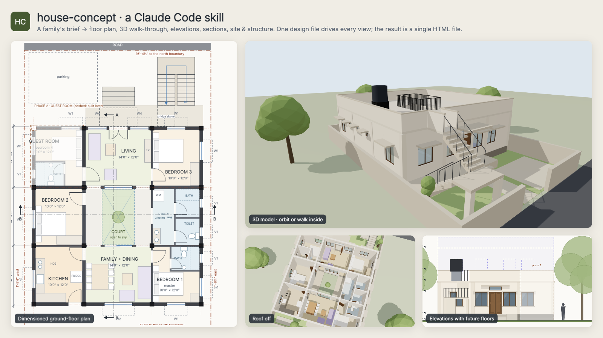

# skills

Agent skills for cleaning up slop in application code, turning a rough brief into a plan folder, proving what a change breaks before it ships, and turning a family's house brief into a concept design.

[](https://skills.sh/imranbarbhuiya/skills)

| Skill | What it does | Folder |
| --- | --- | --- |
| `unslop` | Rules for clean application code: no low-evidence types, special-case patches, hidden failures, over-engineering, duplication, tangled structure, dead leftovers, hardcoded theme values, string-matched URLs, or tests that cannot fail. | [`skills/unslop`](skills/unslop) |
| `grill-to-plan` | Grills you round by round, writes a plan folder with a numbered decision log and one file per task, then orchestrates subagents through it when you say start. | [`skills/grill-to-plan`](skills/grill-to-plan) |
| `blast-radius` | Finds what a change breaks outside its diff, across callers, contracts and repos, and proves the fact it is safe because of by running real code. | [`skills/blast-radius`](skills/blast-radius) |
| `house-concept` | Turns a house brief (a sketch, a plot size, a list of rooms) into a concept design app: plan, 3D walk-through, elevations, sections, site, structural grid brief and cost notes, from one design file, as a single HTML file. | [`skills/house-concept`](skills/house-concept) |

## Install

Uses the [skills](https://github.com/vercel-labs/skills) CLI:

```bash
npx skills add imranbarbhuiya/skills
```

List first:

```bash
npx skills add imranbarbhuiya/skills --list
```

Install one skill, skip prompts:

```bash
npx skills add imranbarbhuiya/skills --skill unslop -y
```

Use once without installing:

```bash
npx skills use imranbarbhuiya/skills@unslop
```

Other source forms:

```bash
npx skills add https://github.com/imranbarbhuiya/skills
npx skills add https://github.com/imranbarbhuiya/skills/tree/main/skills/unslop
```

`unslop` and `blast-radius` are available for the agent to apply on its own: `unslop` while it writes and edits application code, `blast-radius` when you ask whether a change is safe and before it pushes a change to shared code, contracts, schemas, config or dependencies. `house-concept` runs when you ask to design or lay out a house, or invoke `/house-concept`. `grill-to-plan` is explicit-only (`disable-model-invocation: true`); invoke it by name.

## unslop

[](https://skills.sh/imranbarbhuiya/skills/unslop)

Reuse what the repo and its design system already have. Fix causes, not symptoms, and let failures surface. Parse at the boundary. Keep known types known. Inline one-use wrappers. Keep features together and dependencies pointing at what changes less. Use design tokens. Delete leftovers. Write tests that fail on a regression.

Examples and stack notes are TypeScript (NestJS, Next.js, TanStack, Expo, React Native). The same philosophy applies in other languages.

The agent should follow it while writing code and run the cleanup on files it just wrote or edited. You can still invoke `/unslop`, or ask it to unslop, tighten types, inline splits, or remove dead code.

It will not rewrite valid code, generated OpenAPI, or staged files unless you say so.

```
skills/unslop/SKILL.md
skills/unslop/examples.md
skills/unslop/tests.md
skills/unslop/agents/openai.yaml
```

Type evidence rules follow [dmmulroy/anti-slop](https://github.com/dmmulroy/anti-slop).

## grill-to-plan

[](https://skills.sh/imranbarbhuiya/skills/grill-to-plan)

Five phases: **learn** the current state before asking, **grill** in rounds until nothing is silently assumed, **write** the plan folder, **set up execution** (how many subagents run at once, whether they commit and push, and whether work lands on the default branch or as one PR per task, recommended from the repo's history), then wait for you to say start and **orchestrate** subagents through the tasks.

Facts come from the codebase, decisions come from you. The output is an overview with a numbered decision log and a status table the orchestrator keeps current, plus one file per task.

Invoke it explicitly: `/grill-to-plan`, or say grill me into a plan, plan this by asking me questions, write a plan folder, or split this into tasks.

```
skills/grill-to-plan/SKILL.md
skills/grill-to-plan/templates.md
skills/grill-to-plan/agents/openai.yaml
```

## blast-radius

[](https://skills.sh/imranbarbhuiya/skills/blast-radius)

Lists of callers are cheap; the job is the breakage grep does not show. It reads the change, including deleted lines, finds the one fact the change is safe because of, and pushes that fact up a proof ladder: said, pointed at a line, walked, ran, reproduced. It checks callers of shared code, API and DB contracts, generated types, stored data, library source at the installed version, and CI, and reports whether design, logic, performance or CI moved. Before a deploy it sorts changes into no-op, safe, needs a step, and problematic but required.

Targets the working tree, a commit or range, a branch, or a PR, across every repo that shares the contract. The agent uses it when you ask "won't this break X?", "safe to merge?", or "what else did that commit break?", and on its own before pushing risky changes. You can still invoke `/blast-radius`.

```
skills/blast-radius/SKILL.md
skills/blast-radius/examples.md
skills/blast-radius/agents/openai.yaml
```

Inspired by the [`blast-radius`](https://github.com/cursor/plugins/blob/main/pstack/skills/blast-radius/SKILL.md) skill in Cursor's pstack.

## house-concept

[](https://skills.sh/imranbarbhuiya/skills/house-concept)



Reads the brief and any sketch first, asks only what changes the geometry (plot and road side, rooms and baths, floors now and later, phasing, must-keeps), defaults the rest and lists the defaults, then builds from a working starter app. Every view comes from one design file, so moving a stair updates the plan, 3D, elevations, sections, site and structure together. Earlier layouts stay on an "Earlier options" tab for comparison.

The output is a Vite + React + three.js project and one self-contained `dist/index.html` you can send to the family. It is a concept only: every sheet carries a disclaimer that a licensed architect and structural engineer do the final design, and the structure sheet is a brief for the engineer, not a design.

```
skills/house-concept/SKILL.md
skills/house-concept/references/architecture.md    code map and recipes (inside stairs, light wells, spiral stairs)
skills/house-concept/references/design-rules.md    room, stair, climate, structure and site rules of thumb
skills/house-concept/assets/starter/               the starter app (example design: a courtyard house)
skills/house-concept/scripts/new-project.sh        copy the starter and install it
skills/house-concept/scripts/check-sheets.js       find text that runs off an SVG sheet
skills/house-concept/examples/courtyard-house/     screenshots of the example
skills/house-concept/agents/openai.yaml
```

## Layout

```
skills/<name>/SKILL.md
```

This is the catalog layout the skills CLI discovers under `skills/`.

## License

MIT
