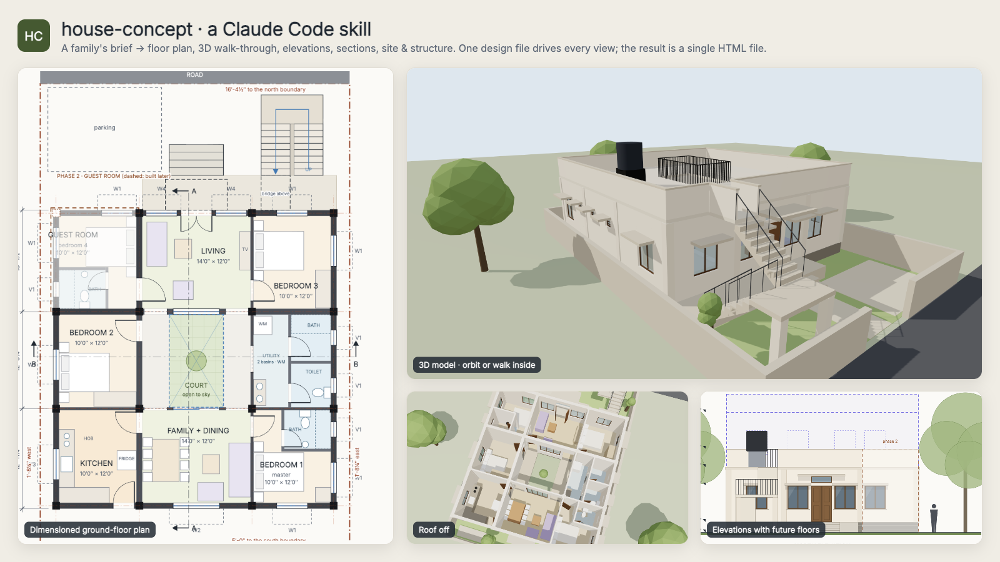
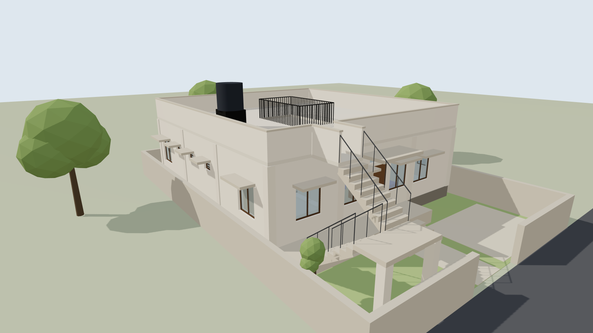
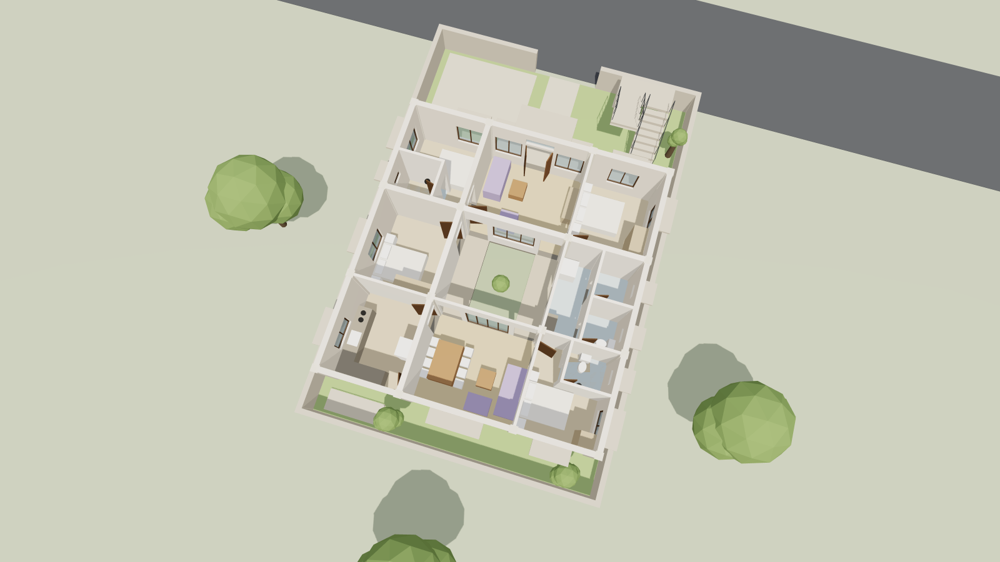
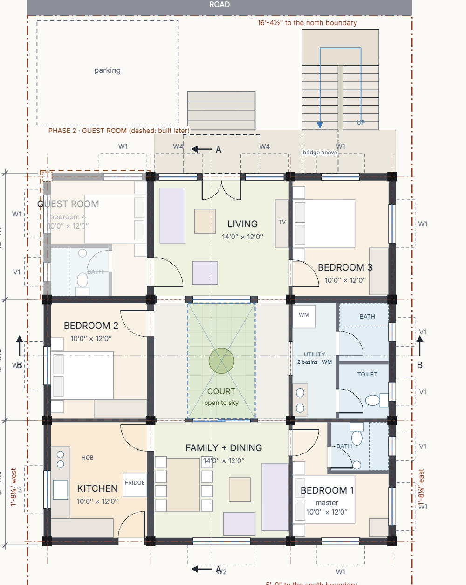
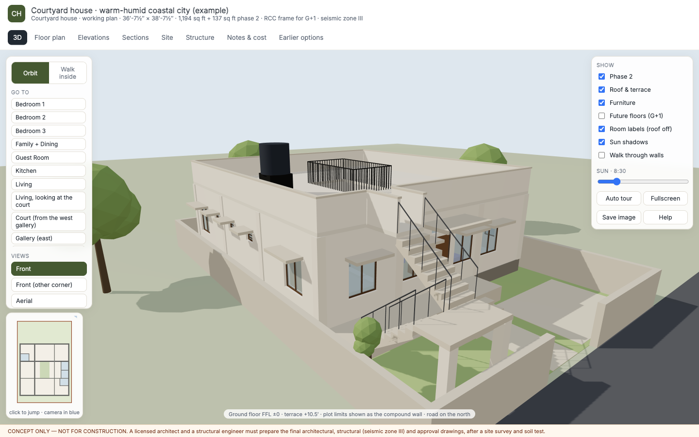
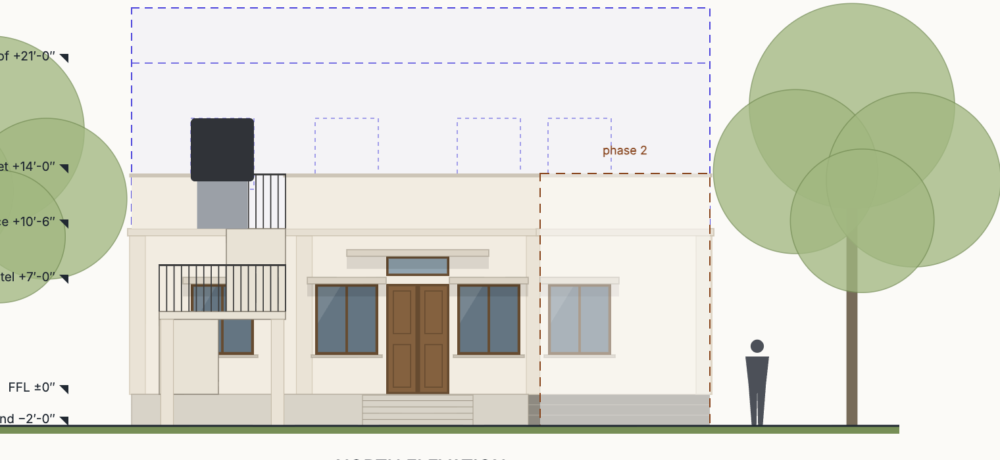
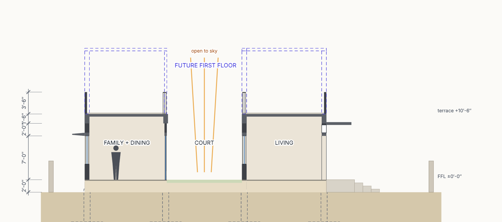
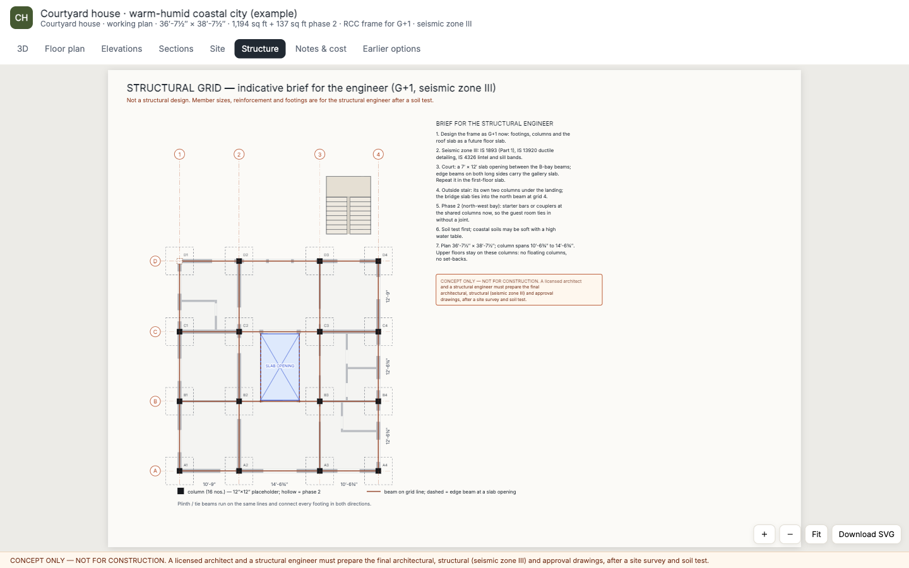

# Example: courtyard house

A made-up brief, built with the starter in `assets/starter` (the design lives in `src/design/house.ts`).

> A 40′ × 60′ plot with the road on the north, in a warm-humid coastal city (seismic zone III). Four bedrooms,
> one with an attached bath, a family room with dining, a separate living room for guests, a kitchen with a back door
> to a wash yard. We like the idea of an open court in the middle. Ground floor now; a first floor later that we may
> let out. Budget about ₹35 lakh.

Questions the skill would still ask (the rest it defaults and lists as assumptions):

1. Which room can wait? → the guest bedroom becomes **phase 2**, with its door from the living room fitted now.
2. If the first floor is let out, should the tenant use your front door? → no: an **outside stair** in the front yard.
3. Court size against bedroom size? → 7′ × 12′ court with 3′-6″ covered galleries, 10′ × 12′ bedrooms.

| | |
| --- | --- |
|  |  |
|  |  |
|  |  |

Concept only, like every output of the skill: a licensed architect and structural engineer do the final design.
